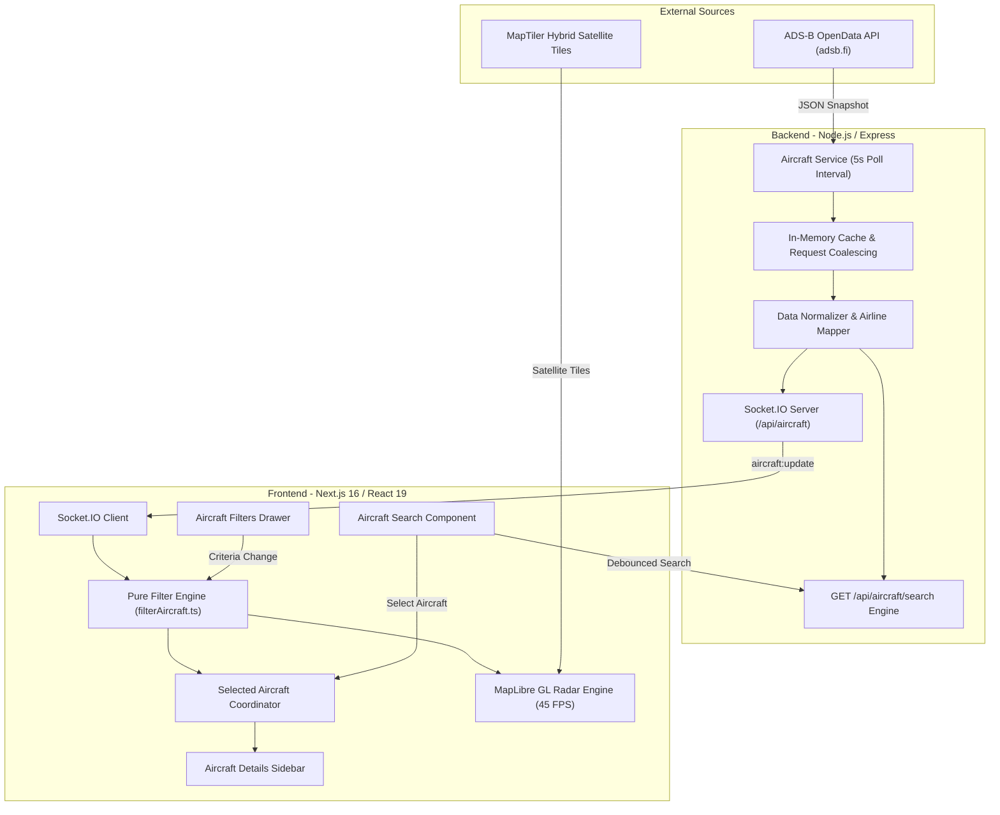

# ✈️ AeroQoraX — Real-Time Flight Radar & Aircraft Tracking

[](https://aeroqorax.vercel.app/)
[](https://nextjs.org/)
[](https://react.dev/)
[](https://www.typescriptlang.org/)
[](https://maplibre.org/)
[](https://socket.io/)

**AeroQoraX** is a production-grade, real-time aircraft tracking radar built with **Next.js 16 (App Router)**, **React 19**, **MapLibre GL**, **Express 5**, and **Socket.IO**. Powered by live ADS-B OpenData transponder feeds, AeroQoraX delivers smooth 45 FPS dead-reckoning animation, sub-second search with verified airline resolution, multi-criteria filtering, and an aviation-grade telemetry sidebar.

🌐 **Live Application:** [https://aeroqorax.vercel.app/](https://aeroqorax.vercel.app/)

---

## 📑 Table of Contents

- [Key Features](#-key-features)
  - [1. Real-Time ADS-B Radar Engine](#1-real-time-ads-b-radar-engine)
  - [2. Advanced Flight Search](#2-advanced-flight-search)
  - [3. Multi-Criteria Aircraft Filtering](#3-multi-criteria-aircraft-filtering)
  - [4. Aircraft Details Sidebar](#4-aircraft-details-sidebar)
- [System Architecture](#-system-architecture)
- [Tech Stack](#-tech-stack)
- [Project Directory Structure](#-project-directory-structure)
- [Getting Started](#-getting-started)
  - [Prerequisites](#prerequisites)
  - [1. Clone the Repository](#1-clone-the-repository)
  - [2. Backend Setup](#2-backend-setup)
  - [3. Frontend Setup](#3-frontend-setup)
- [Environment Variables](#-environment-variables)
- [Available Scripts & Testing](#-available-scripts--testing)
- [API & Real-Time Events](#-api--real-time-events)
- [Data Integrity & Aviation Safety](#-data-integrity--aviation-safety)
- [License](#-license)

---

## 🚀 Key Features

### 1. Real-Time ADS-B Radar Engine
- **Live ADS-B Ingestion**: Streams transponder broadcasts within a 250 NM radius from `https://opendata.adsb.fi/api/v3`.
- **45 FPS Dead-Reckoning Physics**: Continuous, fluid aircraft movement between 5-second polling intervals using spherical forward projection:
  $$\text{Next Position} = f(\text{lat}, \text{lon}, \text{groundSpeed}, \text{heading}, \Delta t)$$
- **Adaptive Drift Correction**: Smooth exponential error decay ($\text{factor} = 1 - e^{-\text{rate} \times \Delta t}$) that gently corrects position errors when fresh GPS observations arrive without visual jumping or snapping.
- **Along-Track Compensation**: Prevents backward teleportation if telemetry indicates deceleration or heading turns.
- **Performance Optimizations**: Bounding-box viewport culling and low-zoom level rendering bypasses (zoom $\le$ 6).
- **Background Tab Protection**: Frame delta clamping guards against animation leaps when switching between browser tabs.

### 2. Advanced Flight Search
- **Instant Autocomplete**: Fast search with debouncing, request cancellation (`AbortController`), and stale response guards.
- **Multi-Field Query Matching**:
  - Flight callsign (e.g., `UBG338`, `BBC147`)
  - Verified commercial flight numbers (e.g., `BS338`, `BG147`)
  - Aircraft registration (e.g., `S2-AJV`, `S2AJV`)
  - ICAO 24-bit hex identifier (e.g., `800ABC`)
  - Partial queries (e.g., `UBG`, `S2`, `338`)
- **Weighted Relevance Ranking**: Priority hierarchy ensures exact callsigns and flight numbers rank highest, followed by prefixes and fuzzy substrings.
- **Camera Navigation**: Click a search result to smoothly fly to the aircraft (`map.flyTo`) and open its telemetry overview.

### 3. Multi-Criteria Aircraft Filtering
- **Airline Filter**: Multi-select filtering powered by verified ICAO prefix resolution (Biman Bangladesh, US-Bangla, Novoair, Air Astra, etc.) plus an `Unknown / Unidentified` option.
- **Non-Overlapping Altitude Bands**:
  - `Ground / Low`: 0 – 1,000 ft
  - `Low`: 1,000 – 10,000 ft
  - `Medium`: 10,000 – 30,000 ft
  - `High`: $\ge$ 30,000 ft
  - `Custom`: User-defined minimum and maximum altitude
- **Ground Speed Presets**: Stationary (0–50 kt), Slow (50–150 kt), Medium (150–350 kt), Fast ($\ge$ 350 kt), and Custom range.
- **Aircraft Type Filter**: Dynamic options extracted live from transponder frames (e.g., `B738`, `A320`, `AT76`).
- **Flight Status Filter**: Strictly derived from transponder state (`alt_baro === 'ground'` or `ground: true`) rather than guessed from speed.
- **Emergency Filter**: Detects special ICAO emergency squawks (`7500` Hijack, `7600` Radio Failure, `7700` General Emergency) and explicit emergency flags.
- **Search Selection Exception**: Selecting an aircraft hidden by active filters reveals it as an exception with a visual alert badge (`⚠ Hidden by Active Filters`) without clearing active filter settings.

### 4. Aircraft Details Sidebar
- **Aviation Glassmorphism Interface**: Desktop right-overlay panel (360–420px) and responsive mobile bottom sheet with touch-friendly controls.
- **Airframe Identity**: Callsign, commercial flight number, verified airline operator, registration, ICAO hex, aircraft type, and model description.
- **Live Flight Telemetry**: Barometric altitude, ground speed, track/heading with cardinal directions, vertical rate with climb/descent trend classification, and hemisphere coordinates ($23.8103^\circ\text{ N}, 90.4125^\circ\text{ E}$).
- **Transponder & Emergency Card**: Squawk code formatting and emergency indicator banners.
- **Data Freshness & Signal-Lost Handling**: Distinguishes active live signals from lost transponder packets; preserves last-known real telemetry and displays a `SIGNAL LOST` indicator with relative elapsed time rather than fabricating extrapolated values.
- **Concise Map Popups**: Synchronized compact map markers with XSS sanitization (`escapeHtml`).

---

## 🏗️ System Architecture



---

## 🛠️ Tech Stack

| Layer | Technologies |
| :--- | :--- |
| **Frontend Framework** | [Next.js 16](https://nextjs.org/) (App Router, Turbopack), [React 19](https://react.dev/) |
| **Language** | [TypeScript 5](https://www.typescriptlang.org/) (Strict typing, `exactOptionalPropertyTypes`) |
| **Map & Geospatial** | [MapLibre GL 6.2](https://maplibre.org/), [MapTiler](https://www.maptiler.com/) Hybrid Satellite Basemaps |
| **Styling & UI** | [Tailwind CSS v4](https://tailwindcss.com/), [Lucide React](https://lucide.dev/) Icons |
| **Backend Framework** | [Express 5](https://expressjs.com/), [Node.js](https://nodejs.org/) |
| **Real-Time Transport**| [Socket.IO 4.8](https://socket.io/) (WebSockets with polling fallback) |
| **HTTP Client** | [Axios](https://axios-http.com/) |
| **Testing** | Node.js native test runner (`node:test`, `node:assert/strict`) via `tsx` |
| **Hosting & Deployment**| [Vercel](https://vercel.com/) (Frontend), Node.js server container |

---

## 📂 Project Directory Structure

```text
AeroQoraX/
├── client/                               # Next.js 16 Frontend
│   ├── app/
│   │   ├── globals.css                   # Tailwind CSS v4 & custom glassmorphism styles
│   │   ├── layout.tsx                    # Root application layout
│   │   └── page.tsx                      # Main radar map view
│   ├── features/
│   │   └── aircraft/
│   │       ├── actions/
│   │       │   └── aircraftSearchAction.ts   # Server-side search proxy action
│   │       ├── components/
│   │       │   ├── aircraft-details-sidebar.tsx # Full flight details panel
│   │       │   ├── aircraft-filters.tsx      # Multi-criteria filter drawer
│   │       │   ├── aircraft-map.tsx          # MapLibre GL radar & animation loop
│   │       │   └── aircraft-search.tsx       # Search bar with autocomplete
│   │       ├── types/
│   │       │   └── aircraft.ts               # Domain types and interfaces
│   │       └── utils/
│   │           ├── aircraftGeoJson.tsx       # GeoJSON FeatureCollection builder
│   │           ├── aircraftMotion.test.ts    # Motion & animation regression tests
│   │           ├── airlineMapping.ts         # Verified ICAO-to-IATA airline maps
│   │           ├── distanceBetweenPoints.ts  # Haversine distance calculations
│   │           ├── filterAircraft.test.ts    # Filter utility test suite
│   │           ├── filterAircraft.ts         # Pure filtering logic & presets
│   │           ├── formatAircraftTelemetry.test.ts # Telemetry format tests
│   │           ├── formatAircraftTelemetry.ts# Sanitization, formatters & squawk decoder
│   │           ├── predictAircraftPosition.ts# Great Circle dead-reckoning projection
│   │           └── selectedAircraftCoordinator.ts # Selection state & snapshot updates
│   ├── lib/
│   │   └── socket.ts                     # Socket.IO client instance
│   ├── package.json
│   └── tsconfig.json
│
├── server/                               # Express 5 Backend
│   ├── src/
│   │   ├── modules/
│   │   │   └── aircraft/
│   │   │       ├── aircraft.service.ts   # ADS-B fetcher, cache & normalizer
│   │   │       ├── aircraft-search.service.ts # Substring & prefix ranking engine
│   │   │       ├── aircraft-search.test.ts    # Search ranking unit tests
│   │   │       ├── airline-mapping.ts    # Backend airline definitions
│   │   │       └── airline-mapping.test.ts    # Airline mapping unit tests
│   │   ├── realtime/
│   │   │   └── socket.ts                 # Socket.IO broadcaster & polling lifecycle
│   │   ├── types/
│   │   │   └── aircraft.ts               # Server domain types
│   │   └── index.ts                      # Express app setup and routes
│   ├── package.json
│   └── tsconfig.json
│
└── README.md
```

---

## 🏁 Getting Started

### Prerequisites
- **Node.js**: `v18.0.0` or higher
- **npm**: `v9.0.0` or higher
- **MapTiler Account**: Free API key from [MapTiler](https://cloud.maptiler.com/) for hybrid satellite map tiles.

### 1. Clone the Repository
```bash
git clone https://github.com/your-username/AeroQoraX.git
cd AeroQoraX
```

### 2. Backend Setup
```bash
cd server
npm install

# Create environment configuration
cp .env.example .env # or create .env as shown below

# Start backend in development mode
npm run dev
```
The server will start listening on `http://localhost:5000`.

### 3. Frontend Setup
In a new terminal window:
```bash
cd client
npm install

# Create environment configuration
cp .env.example .env.local # or create .env as shown below

# Start client in development mode
npm run dev
```
Open [http://localhost:3000](http://localhost:3000) in your browser.

---

## 🔑 Environment Variables

### Client (`client/.env`)
```env
# MapTiler API Key for vector and hybrid satellite tiles
NEXT_PUBLIC_MAPTILER_KEY=your_maptiler_api_key_here

# Backend REST API endpoint
NEXT_PUBLIC_API_URL=http://localhost:5000/

# Backend WebSocket URL
NEXT_PUBLIC_SOCKET_URL=http://localhost:5000/
```

### Server (`server/.env`)
```env
# Server Port
PORT=5000

# Client origin for CORS authorization
CLIENT_URL=http://localhost:3000

# ADS-B OpenData feed provider
ADSB_BASE_URL=https://opendata.adsb.fi/api/v3
```

---

## 🧪 Available Scripts & Testing

Both the client and server include unit test suites built using the Node.js native test runner (`node:test`).

### Run Client Tests & Verification
```bash
cd client

# Run all unit and regression tests (38 tests)
npm test

# Run ESLint (React 19 / Next.js 16 rules)
npm run lint

# Build production bundle with Turbopack
npm run build
```

### Run Server Tests & Verification
```bash
cd server

# Run backend unit tests (17 tests)
npm test

# Type-check and compile TypeScript
npm run build
```

---

## 📡 API & Real-Time Events

### REST Endpoints

| Method | Endpoint | Description |
| :--- | :--- | :--- |
| `GET` | `/api/aircraft` | Returns current snapshot of all normalized aircraft within radar coverage. |
| `GET` | `/api/aircraft/search?q={query}&limit={limit}` | Searches aircraft by callsign, flight number, registration, hex ID, or airline. |

### Socket.IO Protocol

- **Event:** `aircraft:update`
  - **Direction:** Server $\to$ Client
  - **Payload:** `Aircraft[]` (Emitted every 5 seconds while at least one client is connected)
  - **Payload Schema:**
    ```typescript
    interface Aircraft {
      id: string;              // 24-bit ICAO Hex ID
      callsign?: string;       // Broadcast flight callsign
      flightNumber?: string;   // Verified commercial flight number
      airline?: string;        // Verified airline name
      registration?: string;   // Aircraft tail registration
      aircraftType?: string;   // ICAO aircraft type code (e.g. B738)
      description?: string;    // Airframe description
      latitude: number;        // Transponder latitude
      longitude: number;       // Transponder longitude
      altitude?: number | "ground"; // Barometric altitude in feet
      groundSpeed?: number;    // Ground speed in knots
      heading?: number;        // Track in degrees (0-359°)
      verticalRate?: number;   // Feet per minute (+/-)
      squawk?: string;         // 4-digit octal transponder squawk
      emergency?: string;      // Emergency declaration status
      onGround?: boolean;      // Flight status
    }
    ```

---

## 🛡️ Data Integrity & Aviation Safety

1. **No Fabricated Information**:
   AeroQoraX adheres strictly to authentic telemetry. If an ADS-B transponder packet omits altitude, speed, or type code, the interface displays `Unavailable` or `Not reported`. Route legs and origin/destination pairs are not manufactured.
2. **Verified Carrier Mappings**:
   Commercial flight numbers (e.g., `BS338` from `UBG338`) and airline names are mapped exclusively when verified ICAO prefix tables are present. Unrecognized callsigns are classified as `Unidentified Airline / Private`.
3. **Cross-Site Scripting (XSS) Sanitization**:
   All untrusted strings from external ADS-B broadcasts (callsigns, descriptions, registrations) are sanitized with HTML entity escaping before rendering in MapLibre popup contexts.
4. **Coordinate Validation**:
   Latitude and longitude boundaries are validated ($\text{lat} \in [-90, 90]$, $\text{lon} \in [-180, 180]$) before triggering camera fly-to actions.

---

## 📄 License

This project is open-source and distributed under the **ISC License**.

